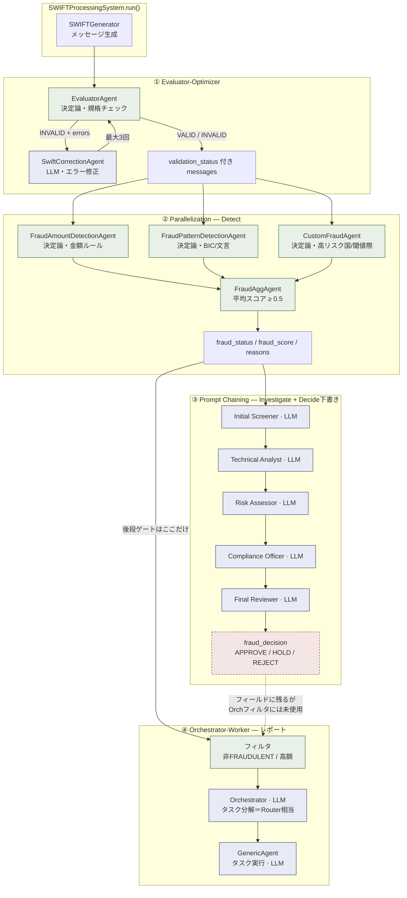
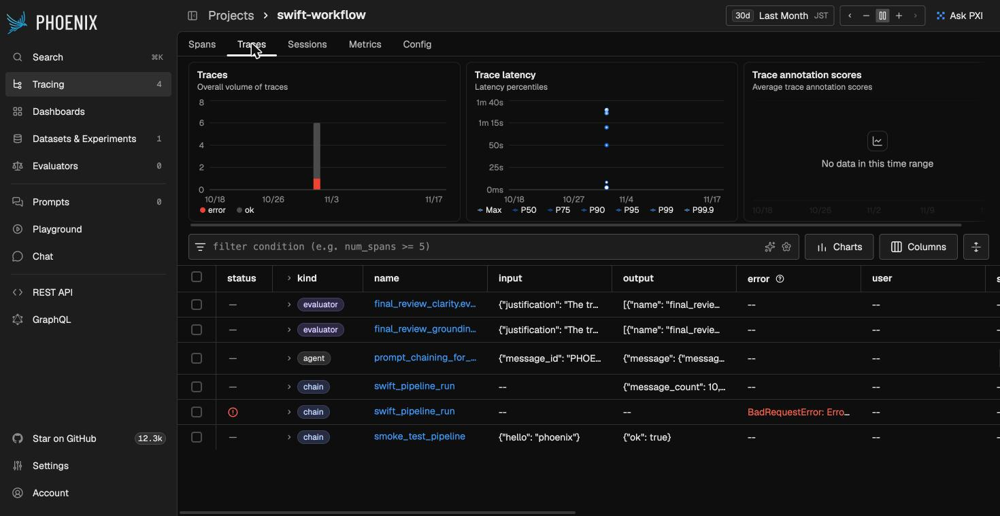
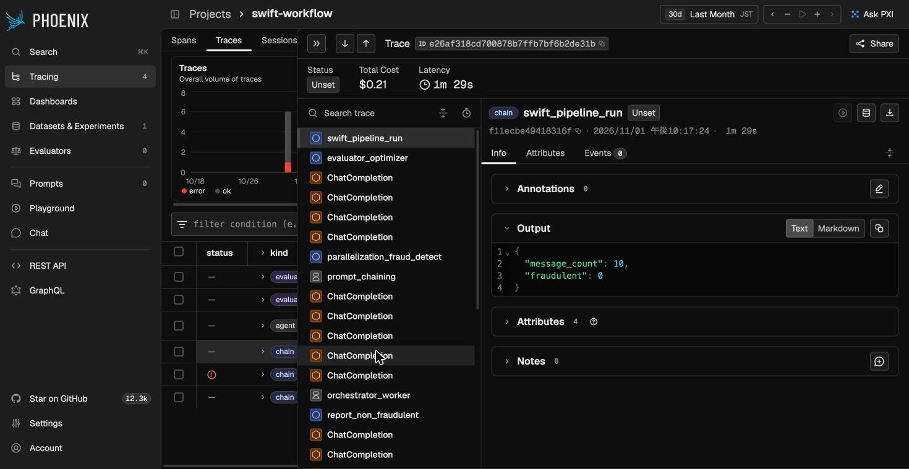
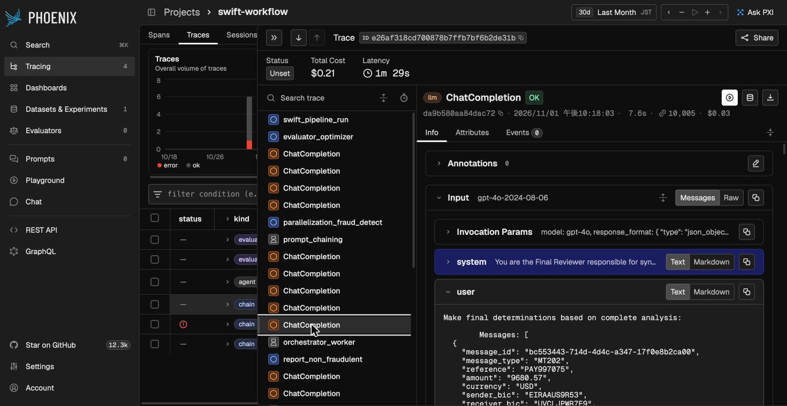
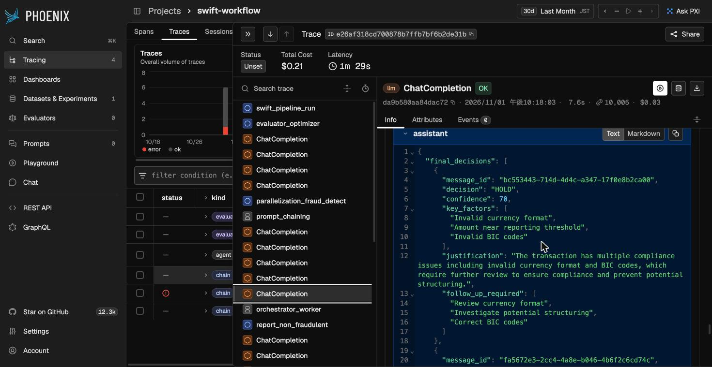
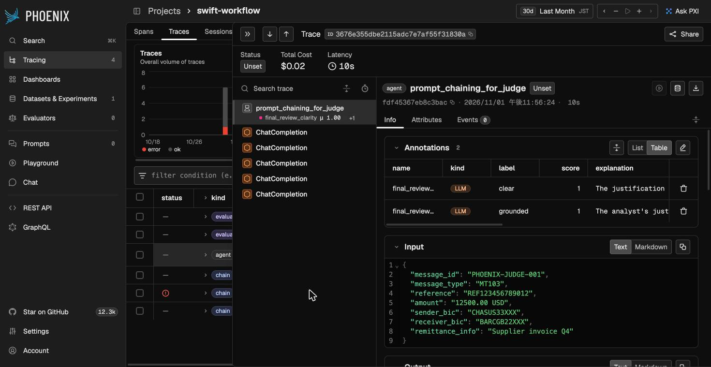

# SWIFT 送金の不正検知パイプラインを Phoenix で観測・評価した記録

> **English summary:** Notes from adding tracing (Arize Phoenix / OpenInference) and evaluations to a four-stage agentic pipeline that screens SWIFT MT103 messages. The trace showed a wiring gap the code review had predicted: the run reported 0 fraudulent messages while the LLM final reviewer put the same message on HOLD, and that decision was never used downstream. Also covers deterministic golden tests, schema checks on live LLM output, and discrete-label LLM-as-a-judge annotations written back to spans. Only my own tracing and evaluation code is included; the pipeline itself was built from the course materials of Course 2, "Agentic AI Workflows for Financial Services", in Udacity's [Agentic AI for Financial Services Nanodegree Program](https://www.udacity.com/course/agentic-ai-for-financial-services--nd902), and is not published here.
>
> **Disclaimer:** This is a personal learning record and does not represent the views of my employer. It is not an official Udacity resource. The SWIFT messages are generated test data, and nothing here is intended for real financial decisions.

SWIFT の送金メッセージ(MT103)を処理するエージェントのパイプラインに、Arize Phoenix のトレースと評価を足し、何が見えて何が分かったかを記録したもの。2026年10〜11月に実施。

パイプラインは、Udacity の [*Agentic AI for Financial Services* Nanodegree Program](https://www.udacity.com/course/agentic-ai-for-financial-services--nd902) の Course 2「Agentic AI Workflows for Financial Services」の課題の素材を利用して実装したもの。パイプライン本体のコードは課題の解答にあたるので、このリポジトリには含めていない。ここにあるのは、自分で足したトレースと評価のコードと、観測した結果だけ。

## パイプラインの構成

緑が決定論(コード)、紫が LLM、赤の点線が配線のギャップ。図は自分でコードを読んで描いたもの。



## Phoenix で見えたもの

パイプラインの1回の実行を1本のトレースにし、4段を子 span にした。OpenAI の呼び出しは OpenInference の自動計装で、それぞれの段の下に `ChatCompletion` としてぶら下がる。



1回の実行(メッセージ10件)は1分29秒、$0.21 だった。どの段で何回 LLM を呼んだかが一目で分かる。



最終判断(Final Reviewer)の LLM 呼び出しを開くと、モデル(gpt-4o)、トークン数(10,005)、コスト、プロンプトの中身が見える。



### トレースで見えた配線のギャップ

この実行の最終出力は `{"message_count": 10, "fraudulent": 0}`、つまり**不正は0件**だった(前の画面の右側)。ところが最終判断の LLM は、同じバッチのメッセージを **HOLD**(保留、確信度70)と判定していた。理由として、通貨の形式の誤り、報告の閾値に近い金額、BIC コードの誤りを挙げ、追加の確認を求めている。



コードを読んだ段階で「LLM の最終判断(`fraud_decision`)は、後段のレポートでも人への引き渡しでも使われていない。後段が見ているのは並列のルールの結果(`fraud_status`)だけ」と見立てていた(上の図の赤の点線)。トレースで、それが実際に起きていることを確かめられた。LLM が HOLD にした取引が、何の確認もなく通っていくことになる。

## 評価

| 段階 | 何を確かめたか | 結果 |
|---|---|---|
| 決定論のゴールデンテスト | 検証のルール(壊した入力 → 期待するエラー)と、不正検知のルール(ルールごとの加点、閾値 0.5、バッチのラベル)。LLM は呼ばない | 18件すべて合格(1秒未満) |
| LLM の出力の形のチェック | 実際に LLM を呼び、各段の JSON のキー、判断が APPROVE / HOLD / REJECT の3択に入っているか、タスクの種類が許可リストにあるか | 4件すべて合格(20〜60秒) |
| LLM-as-a-judge | 最終判断の根拠について、`grounded / not_grounded` と `clear / unclear` の2つのラベルを付け、span に注釈として書き戻す | 仕組みを、評価用に作った1件のメッセージで試した |

LLM-as-a-judge は、点数ではなく離散のラベルにした(Arize の推奨に沿った)。Phoenix からトレースを取り出し、`phoenix.evals` の分類器で判定し、結果を span の注釈として戻している。



## 作って分かったこと

1. **トレースは「動いたか」だけでなく、「判断が使われたか」を確かめる道具になる。** HOLD と判定されたのに不正0件で終わったことは、ログやテストだけでは気づきにくい。
2. **検知はルール(決定論)、調査は LLM の下書き、最終判断は人かルールのゲート、と分けて考えると、評価の当て方が決まる。** 決定論の部分はゴールデンテストで固定でき、LLM の部分は形のチェックと judge で見る。
3. **このパイプラインには、ほかにも直すべき点がある。** 不正検知で絞り込まずに全件が LLM 5段の審査に入るのでコストが最大になる。LLM 呼び出しが失敗すると空の結果のまま次に進む。HOLD を人に回す処理が無い。

## このリポジトリにあるコード

自分で書いたトレースと評価のコードだけ。パイプライン本体が無いので、単体では動かない。

| ファイル | 内容 |
|---|---|
| [code/phoenix_tracing.py](code/phoenix_tracing.py) | Phoenix への送信と OpenAI の自動計装の設定。パイプラインの段を span にするヘルパー(`traced_stage`) |
| [code/phoenix_llm_judge.py](code/phoenix_llm_judge.py) | Phoenix からトレースを取り出し、LLM-as-a-judge で2つのラベルを付けて、span に書き戻す |
| [code/llm_judge.py](code/llm_judge.py) | judge のプロンプトを、正解の分かっている例で確かめるための版 |

パイプラインの側では、各段を次のように囲んだ。

```python
with traced_stage("evaluator_optimizer", kind="CHAIN",
                  input_value={"message_count": len(messages)}) as span:
    validated = self.evaluator_optimizer.process_with_evaluator_optimizer(messages)
    valid = sum(1 for m in validated if m.get("validation_status") == "VALID")
    set_span_output(span, {"message_count": len(validated), "valid": valid,
                           "invalid": len(validated) - valid})
```

## 限界

- 送金メッセージは生成したテストデータで、実際の取引ではない。
- LLM-as-a-judge は1件で仕組みを試しただけで、人の判断と突き合わせた校正はしていない。
- 最終判断の5段を別々の span に分けること、メッセージ単位の span は、まだやっていない。
- パイプラインの実行のうち1本は API エラー(`BadRequestError`)で失敗している(トレース一覧の赤い行)。

## 参考

- [Arize Phoenix](https://github.com/Arize-ai/phoenix)
- [OpenInference](https://github.com/Arize-ai/openinference)
- Udacity [Agentic AI for Financial Services Nanodegree Program](https://www.udacity.com/course/agentic-ai-for-financial-services--nd902)(パイプラインの素材)
- DeepLearning.AI × Arize の短期コース *Evaluating AI Agents*(評価の考え方の出典)

## 免責

個人の学習・検証の記録で、所属組織の見解を示すものではない。Udacity の公式な資料ではない。実際の業務や金融取引の判断に使うことは想定していない。
